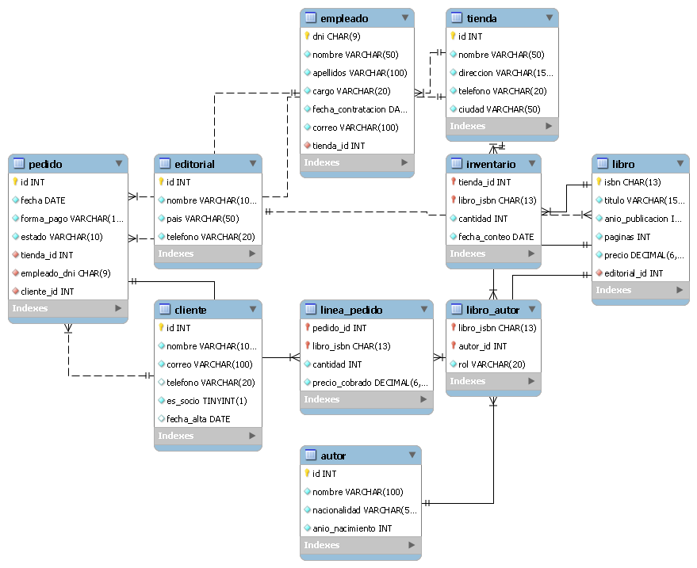

# Base de datos de Páginas de Villa Serena

## Autores

- Dani (daaniidev)
- Hector (abenia26)


**Módulo:** 0488 · 2º DAM · Trabajo Nº1 · RA6 · Fase 3

## Índice

1. [Resumen del caso](#1-resumen-del-caso)
2. [Análisis del caso](#2-análisis-del-caso)
   - [2.1 Entidades y atributos](#21-entidades-y-atributos)
   - [2.2 Relaciones](#22-relaciones)
   - [2.3 Datos descartados](#23-datos-descartados)
3. [Reglas de negocio](#3-reglas-de-negocio)
4. [Diagrama entidad-relación](#4-diagrama-entidad-relación)
5. [Modelo lógico](#5-modelo-lógico)
6. [Script SQL (schema.sql)](#6-script-sql-schemasql)
7. [Diccionario de datos](#7-diccionario-de-datos)
8. [Decisiones de diseño](#8-decisiones-de-diseño)
9. [Datos de prueba](#9-datos-de-prueba)
10. [Consultas de prueba](#10-consultas-de-prueba)
11. [Limitaciones y mejoras futuras](#11-limitaciones-y-mejoras-futuras)

---

## 1. Resumen del caso

Páginas de Villa Serena es una librería con tres tiendas: Centro, Ribera (en Aldeaverde) y Universidad. Su dueña, Elena Ruiz, lleva el control de cada tienda en una hoja de cálculo distinta. El problema es que esas hojas no coinciden con lo que hay en las estanterías. Un cliente pidió *Cien años de soledad* en Centro, la hoja decía que había tres copias y las tres estaban en Universidad.

Elena necesita una base de datos única donde conste cuántas copias de cada libro hay en cada tienda y cuándo se contaron por última vez. También quiere guardar los libros con sus autores y su editorial, los empleados de cada tienda y los clientes. Y los pedidos, con los libros que lleva cada uno y el precio que se cobró en ese momento, para que las facturas antiguas no cambien cuando suba el precio de un libro.

Con esa base de datos Elena quiere poder contestar preguntas como qué libros hay en cada tienda, cuánto ha facturado cada una o qué empleado ha atendido más pedidos.

## 2. Análisis del caso

### 2.1 Entidades y atributos

| Entidad | Atributos encontrados | Fragmento del caso |
|---|---|---|
| Tienda | nombre, dirección, teléfono, ciudad | «cada una tiene su nombre, su dirección, su teléfono y su ciudad» (§1) |
| Libro | ISBN, título, año de publicación, páginas, precio de catálogo | «se identifica por su ISBN (13 cifras), y de cada uno guardan el título, el año de publicación, el número de páginas y el precio de catálogo» (§2) |
| Editorial | nombre, país, teléfono | «de cada editorial anotan su nombre, el país y un teléfono de contacto» (§2) |
| Autor | nombre, nacionalidad, año de nacimiento | «de cada autor guardamos el nombre, la nacionalidad y el año de nacimiento» (§2) |
| Inventario (libro en tienda) | cantidad, fecha del último conteo | «cuántas copias hay, y cuándo se contó por última vez» (§3) |
| Empleado | DNI, nombre, apellidos, cargo, fecha de contratación, correo | «el DNI, el nombre y los apellidos, el cargo (librero, cajero o encargado), la fecha de contratación y el correo de trabajo» (§4) |
| Cliente | nombre, correo, teléfono (opcional), si es socio, fecha de alta | «el nombre completo, el correo electrónico (único, lo usan para enviar avisos), el teléfono (opcional) y la fecha de alta» y «Los clientes que compran sin ser socios se registran igualmente con su nombre y correo» (§5) |
| Pedido | número, fecha, forma de pago, estado | «Pedido nº: 10482» en el ticket y «Tiene una fecha, una forma de pago (efectivo, tarjeta o bizum) y un estado» (§6) |
| Línea de pedido | cantidad, precio cobrado | «de cada uno me interesa la cantidad» y «lo que realmente se cobró» (§6) |

También sale la relación entre libro y autor con un dato propio: el rol (principal o colaborador) (§2).

### 2.2 Relaciones

| Relación | Cardinalidad | Razonamiento |
|---|---|---|
| Editorial – Libro | 1:N | Una editorial publica muchos libros. Cada libro lo publica una sola editorial. |
| Libro – Autor | N:M | Un libro puede tener varios autores y un autor puede tener muchos libros. Se resuelve con `libro_autor`, que guarda el rol. |
| Tienda – Libro | N:M | Una tienda tiene muchos libros y un libro está en varias tiendas. Se resuelve con `inventario`, que guarda la cantidad y la fecha de conteo. |
| Tienda – Empleado | 1:N | En una tienda trabajan varios empleados. Cada empleado trabaja en una sola tienda. |
| Tienda – Pedido | 1:N | Un pedido se hace siempre en una tienda y una tienda tiene muchos pedidos. |
| Empleado – Pedido | 1:N | Un empleado atiende muchos pedidos. Cada pedido lo atiende un empleado. |
| Cliente – Pedido | 1:N | Un cliente hace muchos pedidos. Cada pedido lo compra un cliente. |
| Pedido – Libro | N:M | Un pedido lleva varios libros y un libro sale en muchos pedidos. Se resuelve con `linea_pedido`, que guarda la cantidad y el precio cobrado. |

### 2.3 Datos descartados

| Dato | Motivo |
|---|---|
| Total del pedido (ticket: 50,50 €) | Se calcula sumando `cantidad * precio_cobrado` de sus líneas. |
| Subtotal de cada línea (el «24,00 €» de Ficciones) | Se calcula multiplicando cantidad por precio. |
| Columna «stock» de la hoja de cálculo | Un stock por libro no sirve con tres tiendas. Se sustituye por `inventario`. |
| «Cortázar / Borges» en una sola celda | Son dos autores. Se guardan como dos filas en `libro_autor`. |
| Editorial repetida en cada fila de la hoja | Se guarda una vez en `editorial` y el libro apunta a ella. |
| Historial de tiendas de un empleado | Elena dice que no le importa. Solo se guarda la tienda actual. |
| Nombre de la tienda, teléfono y cargo del empleado en el ticket | Ya están en `tienda` y `empleado`. El pedido solo guarda las claves foráneas. |

## 3. Reglas de negocio

1. Una tienda tiene nombre, dirección, teléfono y ciudad. El nombre de cada tienda es único.
2. Cada libro se identifica por su ISBN, formado por 13 cifras. Su precio de catálogo no puede ser negativo y su número de páginas debe ser mayor que 0.
3. Un libro lo publica una única editorial y una editorial publica muchos libros. No puede haber dos editoriales con el mismo nombre.
4. Un libro puede tener varios autores y un autor puede tener varios libros. En cada libro, cada autor es principal o colaborador.
5. Para cada libro y cada tienda se guarda cuántas copias hay y la fecha del último conteo. Si un libro no está en una tienda, no hay fila. La cantidad no puede ser negativa.
6. Cada empleado trabaja en una sola tienda. Su cargo es librero, cajero o encargado. Su correo de trabajo es único.
7. El correo de un cliente es único. El teléfono es opcional. Si el cliente es socio, se guarda su fecha de alta.
8. Un pedido se hace en una sola tienda, lo atiende un solo empleado y lo compra un solo cliente.
9. La forma de pago de un pedido es efectivo, tarjeta o bizum. Su estado es preparado, entregado o cancelado.
10. Un pedido lleva varios libros distintos. De cada uno se guarda la cantidad, que debe ser mayor que 0.
11. Cada línea de pedido guarda el precio que se cobró en ese momento, que no puede ser negativo y no cambia aunque el libro suba de precio.

## 4. Diagrama entidad-relación



Las tablas intermedias de las relaciones N:M son `libro_autor`, `inventario` y `linea_pedido`. En el dibujo cada tabla intermedia se une a sus dos tablas con relaciones 1:N.

| Relación | Tipo | Cómo se resuelve |
|---|---|---|
| editorial – libro | 1:N | `libro.editorial_id` |
| libro – autor | N:M | Tabla intermedia `libro_autor` (con `rol`) |
| tienda – libro | N:M | Tabla intermedia `inventario` (con `cantidad` y `fecha_conteo`) |
| tienda – empleado | 1:N | `empleado.tienda_id` |
| tienda – pedido | 1:N | `pedido.tienda_id` |
| empleado – pedido | 1:N | `pedido.empleado_dni` |
| cliente – pedido | 1:N | `pedido.cliente_id` |
| pedido – libro | N:M | Tabla intermedia `linea_pedido` (con `cantidad` y `precio_cobrado`) |

## 5. Modelo lógico

**`editorial`**

| Columna | Clave | Referencia |
|---|---|---|
| `id` | PK | |
| `nombre` | | |
| `pais` | | |
| `telefono` | | |

**`libro`**

| Columna | Clave | Referencia |
|---|---|---|
| `isbn` | PK | |
| `titulo` | | |
| `anio_publicacion` | | |
| `paginas` | | |
| `precio` | | |
| `editorial_id` | FK | `editorial.id` |

**`autor`**

| Columna | Clave | Referencia |
|---|---|---|
| `id` | PK | |
| `nombre` | | |
| `nacionalidad` | | |
| `anio_nacimiento` | | |

**`libro_autor`**

| Columna | Clave | Referencia |
|---|---|---|
| `libro_isbn` | PK, FK | `libro.isbn` |
| `autor_id` | PK, FK | `autor.id` |
| `rol` | | |

**`tienda`**

| Columna | Clave | Referencia |
|---|---|---|
| `id` | PK | |
| `nombre` | | |
| `direccion` | | |
| `telefono` | | |
| `ciudad` | | |

**`inventario`**

| Columna | Clave | Referencia |
|---|---|---|
| `tienda_id` | PK, FK | `tienda.id` |
| `libro_isbn` | PK, FK | `libro.isbn` |
| `cantidad` | | |
| `fecha_conteo` | | |

**`empleado`**

| Columna | Clave | Referencia |
|---|---|---|
| `dni` | PK | |
| `nombre` | | |
| `apellidos` | | |
| `cargo` | | |
| `fecha_contratacion` | | |
| `correo` | | |
| `tienda_id` | FK | `tienda.id` |

**`cliente`**

| Columna | Clave | Referencia |
|---|---|---|
| `id` | PK | |
| `nombre` | | |
| `correo` | | |
| `telefono` | | |
| `es_socio` | | |
| `fecha_alta` | | |

**`pedido`**

| Columna | Clave | Referencia |
|---|---|---|
| `id` | PK | |
| `fecha` | | |
| `forma_pago` | | |
| `estado` | | |
| `tienda_id` | FK | `tienda.id` |
| `empleado_dni` | FK | `empleado.dni` |
| `cliente_id` | FK | `cliente.id` |

**`linea_pedido`**

| Columna | Clave | Referencia |
|---|---|---|
| `pedido_id` | PK, FK | `pedido.id` |
| `libro_isbn` | PK, FK | `libro.isbn` |
| `cantidad` | | |
| `precio_cobrado` | | |

## 6. Script SQL (schema.sql)

Cada tabla se crea después de las tablas a las que apuntan sus claves foráneas. Por ejemplo, `libro` va después de `editorial` y `pedido` va después de `tienda`, `empleado` y `cliente`. El script se ha probado desde cero en una base de datos vacía.

```sql
DROP DATABASE IF EXISTS libreria;
CREATE DATABASE libreria CHARACTER SET utf8mb4;
USE libreria;

CREATE TABLE editorial (
    id        INT          PRIMARY KEY AUTO_INCREMENT,
    nombre    VARCHAR(100) NOT NULL UNIQUE,
    pais      VARCHAR(50)  NOT NULL,
    telefono  VARCHAR(20)  NOT NULL
);

CREATE TABLE autor (
    id                INT          PRIMARY KEY AUTO_INCREMENT,
    nombre            VARCHAR(100) NOT NULL,
    nacionalidad      VARCHAR(50)  NOT NULL,
    anio_nacimiento   INT          NOT NULL
);

CREATE TABLE libro (
    isbn           CHAR(13)      PRIMARY KEY CHECK (isbn REGEXP '^[0-9]{13}$'),
    titulo         VARCHAR(150)  NOT NULL,
    anio_publicacion INT         NOT NULL,
    paginas        INT           NOT NULL CHECK (paginas > 0),
    precio         DECIMAL(6,2)  NOT NULL CHECK (precio >= 0),
    editorial_id   INT           NOT NULL,
    FOREIGN KEY (editorial_id) REFERENCES editorial(id)
);

CREATE TABLE libro_autor (
    libro_isbn  CHAR(13)    NOT NULL,
    autor_id    INT         NOT NULL,
    rol         VARCHAR(20) NOT NULL CHECK (rol IN ('principal', 'colaborador')),
    PRIMARY KEY (libro_isbn, autor_id),
    FOREIGN KEY (libro_isbn) REFERENCES libro(isbn),
    FOREIGN KEY (autor_id)   REFERENCES autor(id)
);

CREATE TABLE tienda (
    id         INT          PRIMARY KEY AUTO_INCREMENT,
    nombre     VARCHAR(50)  NOT NULL UNIQUE,
    direccion  VARCHAR(150) NOT NULL,
    telefono   VARCHAR(20)  NOT NULL,
    ciudad     VARCHAR(50)  NOT NULL
);

CREATE TABLE inventario (
    tienda_id       INT      NOT NULL,
    libro_isbn      CHAR(13) NOT NULL,
    cantidad        INT      NOT NULL CHECK (cantidad >= 0),
    fecha_conteo    DATE     NOT NULL,
    PRIMARY KEY (tienda_id, libro_isbn),
    FOREIGN KEY (tienda_id)  REFERENCES tienda(id),
    FOREIGN KEY (libro_isbn) REFERENCES libro(isbn)
);

CREATE TABLE empleado (
    dni                CHAR(9)      PRIMARY KEY,
    nombre             VARCHAR(50)  NOT NULL,
    apellidos          VARCHAR(100) NOT NULL,
    cargo              VARCHAR(20)  NOT NULL CHECK (cargo IN ('librero', 'cajero', 'encargado')),
    fecha_contratacion DATE         NOT NULL,
    correo             VARCHAR(100) NOT NULL UNIQUE,
    tienda_id          INT          NOT NULL,
    FOREIGN KEY (tienda_id) REFERENCES tienda(id)
);

CREATE TABLE cliente (
    id          INT          PRIMARY KEY AUTO_INCREMENT,
    nombre      VARCHAR(100) NOT NULL,
    correo      VARCHAR(100) NOT NULL UNIQUE,
    telefono    VARCHAR(20),
    es_socio    BOOLEAN      NOT NULL DEFAULT FALSE,
    fecha_alta  DATE,
    CHECK (es_socio = FALSE OR fecha_alta IS NOT NULL)
);

CREATE TABLE pedido (
    id           INT         PRIMARY KEY AUTO_INCREMENT,
    fecha        DATE        NOT NULL,
    forma_pago   VARCHAR(10) NOT NULL CHECK (forma_pago IN ('efectivo', 'tarjeta', 'bizum')),
    estado       VARCHAR(10) NOT NULL CHECK (estado IN ('preparado', 'entregado', 'cancelado')),
    tienda_id    INT         NOT NULL,
    empleado_dni CHAR(9)     NOT NULL,
    cliente_id   INT         NOT NULL,
    FOREIGN KEY (tienda_id)    REFERENCES tienda(id),
    FOREIGN KEY (empleado_dni) REFERENCES empleado(dni),
    FOREIGN KEY (cliente_id)   REFERENCES cliente(id)
);

CREATE TABLE linea_pedido (
    pedido_id       INT          NOT NULL,
    libro_isbn      CHAR(13)     NOT NULL,
    cantidad        INT          NOT NULL CHECK (cantidad > 0),
    precio_cobrado  DECIMAL(6,2) NOT NULL CHECK (precio_cobrado >= 0),
    PRIMARY KEY (pedido_id, libro_isbn),
    FOREIGN KEY (pedido_id)  REFERENCES pedido(id),
    FOREIGN KEY (libro_isbn) REFERENCES libro(isbn)
);
```

## 7. Diccionario de datos

**`editorial`**

| Columna | Tipo | Obligatorio | Descripción |
|---|---|:---:|---|
| `id` | `INT` | Sí | Identificador que asigna MySQL automáticamente. |
| `nombre` | `VARCHAR(100)` | Sí | Nombre comercial de la editorial. No se repite. |
| `pais` | `VARCHAR(50)` | Sí | País donde está la editorial. |
| `telefono` | `VARCHAR(20)` | Sí | Teléfono al que se llama para hacer pedidos. |

**`libro`**

| Columna | Tipo | Obligatorio | Descripción |
|---|---|:---:|---|
| `isbn` | `CHAR(13)` | Sí | Código ISBN. Identifica al libro. Solo admite 13 cifras, sin guiones ni letras. |
| `titulo` | `VARCHAR(150)` | Sí | Título del libro tal como aparece en el catálogo. |
| `anio_publicacion` | `INT` | Sí | Año en que se publicó. |
| `paginas` | `INT` | Sí | Número de páginas. Debe ser mayor que 0. |
| `precio` | `DECIMAL(6,2)` | Sí | Precio de catálogo actual en euros. Los pedidos antiguos no lo usan, guardan su propio precio. No puede ser negativo. |
| `editorial_id` | `INT` | Sí | Editorial que publica el libro. |

**`autor`**

| Columna | Tipo | Obligatorio | Descripción |
|---|---|:---:|---|
| `id` | `INT` | Sí | Identificador automático del autor. |
| `nombre` | `VARCHAR(100)` | Sí | Nombre completo del autor. |
| `nacionalidad` | `VARCHAR(50)` | Sí | País de origen del autor. |
| `anio_nacimiento` | `INT` | Sí | Año en que nació. |

**`libro_autor`**

| Columna | Tipo | Obligatorio | Descripción |
|---|---|:---:|---|
| `libro_isbn` | `CHAR(13)` | Sí | Libro escrito. Junto con `autor_id` forma la clave primaria, así que un autor no se repite en el mismo libro. |
| `autor_id` | `INT` | Sí | Autor que participa en el libro. |
| `rol` | `VARCHAR(20)` | Sí | Papel del autor en ese libro: `principal` o `colaborador` (por ejemplo, quien hace el prólogo). |

**`tienda`**

| Columna | Tipo | Obligatorio | Descripción |
|---|---|:---:|---|
| `id` | `INT` | Sí | Identificador automático de la tienda. |
| `nombre` | `VARCHAR(50)` | Sí | Nombre de la tienda (Centro, Ribera, Universidad). No se repite. |
| `direccion` | `VARCHAR(150)` | Sí | Calle y número de la tienda. |
| `telefono` | `VARCHAR(20)` | Sí | Teléfono de la tienda. |
| `ciudad` | `VARCHAR(50)` | Sí | Localidad donde está la tienda. |

**`inventario`**

| Columna | Tipo | Obligatorio | Descripción |
|---|---|:---:|---|
| `tienda_id` | `INT` | Sí | Tienda donde están las copias. |
| `libro_isbn` | `CHAR(13)` | Sí | Libro contado. La pareja `tienda_id` + `libro_isbn` es única. |
| `cantidad` | `INT` | Sí | Copias que había en esa tienda en el último conteo. Puede ser 0, no negativa. |
| `fecha_conteo` | `DATE` | Sí | Día en que se contaron las copias por última vez. |

**`empleado`**

| Columna | Tipo | Obligatorio | Descripción |
|---|---|:---:|---|
| `dni` | `CHAR(9)` | Sí | DNI del empleado. Identifica la fila. |
| `nombre` | `VARCHAR(50)` | Sí | Nombre del empleado, sin apellidos. Es el que sale en el ticket («Atendido por: Marta»). |
| `apellidos` | `VARCHAR(100)` | Sí | Primer y segundo apellido, separados de `nombre` para poder ordenar y buscar por ellos. |
| `cargo` | `VARCHAR(20)` | Sí | Puesto: `librero`, `cajero` o `encargado`. |
| `fecha_contratacion` | `DATE` | Sí | Día en que se contrató. |
| `correo` | `VARCHAR(100)` | Sí | Correo de trabajo. No se repite. |
| `tienda_id` | `INT` | Sí | Tienda donde trabaja ahora. |

**`cliente`**

| Columna | Tipo | Obligatorio | Descripción |
|---|---|:---:|---|
| `id` | `INT` | Sí | Identificador automático del cliente. |
| `nombre` | `VARCHAR(100)` | Sí | Nombre completo. |
| `correo` | `VARCHAR(100)` | Sí | Correo para avisos y novedades. No se repite. |
| `telefono` | `VARCHAR(20)` | No | Teléfono de contacto. Puede quedar vacío (`NULL`). |
| `es_socio` | `BOOLEAN` | Sí | `TRUE` si el cliente es socio y tiene descuentos. Por defecto `FALSE`. |
| `fecha_alta` | `DATE` | No | Día en que se hizo socio. Es obligatoria si `es_socio` es `TRUE` y queda en `NULL` si no es socio. |

**`pedido`**

| Columna | Tipo | Obligatorio | Descripción |
|---|---|:---:|---|
| `id` | `INT` | Sí | Número de pedido (el «Pedido nº» del ticket). |
| `fecha` | `DATE` | Sí | Día de la compra. |
| `forma_pago` | `VARCHAR(10)` | Sí | `efectivo`, `tarjeta` o `bizum`. |
| `estado` | `VARCHAR(10)` | Sí | `preparado`, `entregado` o `cancelado`. |
| `tienda_id` | `INT` | Sí | Tienda donde se hizo el pedido. |
| `empleado_dni` | `CHAR(9)` | Sí | Empleado que atendió el pedido. |
| `cliente_id` | `INT` | Sí | Cliente que compró. |

**`linea_pedido`**

| Columna | Tipo | Obligatorio | Descripción |
|---|---|:---:|---|
| `pedido_id` | `INT` | Sí | Pedido al que pertenece la línea. |
| `libro_isbn` | `CHAR(13)` | Sí | Libro comprado. Un libro aparece una sola vez por pedido. |
| `cantidad` | `INT` | Sí | Copias compradas. Debe ser mayor que 0. |
| `precio_cobrado` | `DECIMAL(6,2)` | Sí | Euros que se cobraron por cada copia en ese momento. No cambia aunque el precio del libro suba después. No puede ser negativo. |

## 8. Decisiones de diseño

**Decisión 1: guardar el precio cobrado en `linea_pedido`.**
**Por qué:** Elena subió *Ficciones* de 10 € a 12 € y no quiere que los pedidos antiguos enseñen el precio nuevo. Con `precio_cobrado` en cada línea, el pedido guarda lo que se pagó de verdad.
**Alternativa descartada:** leer siempre `libro.precio`. Las facturas antiguas cambiarían cada vez que se actualice el catálogo.

**Decisión 2: usar una tabla `inventario` en lugar de una columna `stock` en `libro`.**
**Por qué:** la relación entre tienda y libro es N:M, porque un libro puede estar en varias tiendas con cantidades distintas. La cantidad y la fecha de conteo son datos de la pareja tienda-libro. Con la clave primaria compuesta (`tienda_id`, `libro_isbn`) y sin fila cuando el libro no está, se cumple lo que pide Elena.
**Alternativa descartada:** una columna `stock` en `libro`, que es lo que causó el fallo de las tres copias en Universidad.

**Decisión 3: separar libros y autores con la tabla `libro_autor`.**
**Por qué:** hay libros con dos o tres autores y autores con muchos libros, así que es una relación N:M. La tabla intermedia también guarda el `rol`. Así se puede buscar «todos los libros de Cortázar» con un `JOIN`, sin mirar títulos.
**Alternativa descartada:** una columna `autor` con texto como «Cortázar / Borges», como en la hoja de Carmen. No se puede buscar bien y repite los nombres.

**Decisión 4: no guardar el total del pedido.**
**Por qué:** el total (50,50 €) se calcula con `SUM(cantidad * precio_cobrado)` de las líneas. Si se guardara, habría que mantenerlo igual que las líneas y podría quedar mal.
**Alternativa descartada:** una columna `total` en `pedido`.

**Decisión 5: una sola tabla `cliente` para socios y no socios.**
**Por qué:** en los dos casos se guardan nombre y correo, y todos los pedidos necesitan un cliente. Un campo `es_socio` y una `fecha_alta` opcional bastan para distinguirlos. Así `pedido.cliente_id` apunta siempre a la misma tabla.
**Alternativa descartada:** dos tablas, `socio` y `cliente`. Habría que decidir a cuál apunta cada pedido.

**Decisión 6: editorial en su propia tabla.**
**Por qué:** en la hoja de Carmen la editorial se repetía en cada fila. Si se corrige el teléfono de Alianza, con una tabla solo se cambia en un sitio.
**Alternativa descartada:** columnas `editorial`, `pais_editorial` y `telefono_editorial` dentro de `libro`.

**Decisión 7: `DECIMAL` para el dinero y `CHAR` para el ISBN y el DNI.**
**Por qué:** `DECIMAL(6,2)` guarda los céntimos exactos, así que el total del ticket da 50,50 € y no 50,49999, como puede pasar con `DOUBLE`. El ISBN y el DNI tienen siempre la misma longitud y no se hacen cuentas con ellos, así que se guardan como texto de longitud fija. El DNI, además, lleva una letra. Las fechas van en `DATE`.
**Alternativa descartada:** `DOUBLE` para los precios y `BIGINT` para el ISBN. Con `DOUBLE` se pueden perder céntimos al sumar, y con `BIGINT` no se puede comprobar fácilmente que el ISBN tiene exactamente 13 cifras.

**Decisión 8: los pedidos cancelados se quedan en la base de datos.**
**Por qué:** el estado `cancelado` ya existe en el caso, así que el pedido se guarda y se marca. En las consultas de facturación se excluyen con `estado <> 'cancelado'`.
**Alternativa descartada:** borrar los pedidos cancelados. Se perdería el registro de lo que pasó.

## 9. Datos de prueba

Están en `datos.sql`. El pedido 10482 es el ticket del caso y los libros y precios salen de la hoja de Carmen. El pedido 10120 es de febrero de 2025, antes de que *Ficciones* subiera de 10 € a 12 €, y por eso guarda el precio antiguo (Decisión 1). Se cargan después de `schema.sql` y en este orden: editoriales, autores, libros, `libro_autor`, tiendas, inventario, empleados, clientes, pedidos y líneas.

```sql
USE libreria;

INSERT INTO editorial (nombre, pais, telefono) VALUES
('Alfaguara', 'España', '913 000 111'),
('Alianza', 'España', '913 000 222'),
('Plaza & Janés', 'España', '934 000 333'),
('Cátedra', 'España', '915 000 444');

INSERT INTO autor (nombre, nacionalidad, anio_nacimiento) VALUES
('Julio Cortázar', 'Argentina', 1914),
('Jorge Luis Borges', 'Argentina', 1899),
('Isabel Allende', 'Chile', 1942),
('Juan Rulfo', 'México', 1917);

INSERT INTO libro (isbn, titulo, anio_publicacion, paginas, precio, editorial_id) VALUES
('9788420471839', 'Rayuela', 1963, 600, 16.50, 1),
('9788420633121', 'Ficciones', 1944, 220, 12.00, 2),
('9788401352836', 'Cuentos de Eva Luna', 1989, 320, 14.90, 3),
('9788420674209', 'Antología del cuento', 2005, 280, 18.00, 2),
('9788437604947', 'Pedro Páramo', 1955, 160, 10.00, 4),
('9788420412146', 'Bestiario', 1951, 190, 11.50, 1);

INSERT INTO libro_autor (libro_isbn, autor_id, rol) VALUES
('9788420471839', 1, 'principal'),
('9788420633121', 2, 'principal'),
('9788401352836', 3, 'principal'),
('9788420674209', 1, 'principal'),
('9788420674209', 2, 'colaborador'),
('9788437604947', 4, 'principal'),
('9788420412146', 1, 'principal');

INSERT INTO tienda (nombre, direccion, telefono, ciudad) VALUES
('Centro', 'Calle Mayor 12', '976 000 111', 'Villa Serena'),
('Ribera', 'Avenida del Río 5', '976 000 222', 'Aldeaverde'),
('Universidad', 'Plaza del Campus 1', '976 000 333', 'Villa Serena');

INSERT INTO inventario (tienda_id, libro_isbn, cantidad, fecha_conteo) VALUES
(1, '9788420471839', 3, '2026-03-01'),
(1, '9788420633121', 0, '2026-03-01'),
(1, '9788437604947', 5, '2026-03-01'),
(1, '9788420412146', 2, '2026-03-01'),
(2, '9788420471839', 2, '2026-03-03'),
(2, '9788401352836', 4, '2026-03-03'),
(3, '9788420471839', 4, '2026-03-02'),
(3, '9788420633121', 2, '2026-03-02'),
(3, '9788401352836', 0, '2026-03-02'),
(3, '9788420674209', 6, '2026-02-28');

INSERT INTO empleado (dni, nombre, apellidos, cargo, fecha_contratacion, correo, tienda_id) VALUES
('11111111A', 'Marta', 'López Gil', 'cajero', '2022-09-01', 'marta.lopez@villaserena.es', 1),
('22222222B', 'Pablo', 'Sanz Ruiz', 'encargado', '2019-02-15', 'pablo.sanz@villaserena.es', 2),
('33333333C', 'Lucía', 'Ferrer Mon', 'librero', '2023-01-10', 'lucia.ferrer@villaserena.es', 3);

INSERT INTO cliente (nombre, correo, telefono, es_socio, fecha_alta) VALUES
('Andrés Pérez', 'andres.p@correo.es', '600111222', TRUE, '2025-05-20'),
('Laura Gómez', 'laura.g@correo.es', NULL, FALSE, NULL),
('Sergio Navarro', 'sergio.n@correo.es', '600333444', TRUE, '2026-01-08');

INSERT INTO pedido (id, fecha, forma_pago, estado, tienda_id, empleado_dni, cliente_id) VALUES
(10120, '2025-02-10', 'efectivo', 'entregado', 1, '11111111A', 2),
(10482, '2026-03-12', 'tarjeta', 'entregado', 1, '11111111A', 1),
(10484, '2026-03-14', 'bizum', 'entregado', 2, '22222222B', 1),
(10485, '2026-03-15', 'tarjeta', 'preparado', 3, '33333333C', 3),
(10486, '2026-03-16', 'efectivo', 'cancelado', 3, '33333333C', 2),
(10487, '2026-03-17', 'tarjeta', 'entregado', 1, '11111111A', 1);

INSERT INTO linea_pedido (pedido_id, libro_isbn, cantidad, precio_cobrado) VALUES
(10120, '9788420633121', 1, 10.00),
(10120, '9788437604947', 2, 10.00),
(10482, '9788420471839', 1, 16.50),
(10482, '9788420633121', 2, 12.00),
(10482, '9788437604947', 1, 10.00),
(10484, '9788401352836', 1, 14.90),
(10484, '9788420471839', 1, 16.50),
(10485, '9788420674209', 1, 18.00),
(10485, '9788420471839', 2, 16.50),
(10486, '9788420633121', 1, 12.00),
(10487, '9788420471839', 3, 16.50),
(10487, '9788420412146', 1, 11.50);
```

Hay 4 editoriales, 4 autores (*Antología del cuento* tiene dos), 6 libros, 3 tiendas, 3 empleados, 3 clientes y 6 pedidos con 12 líneas (5 de ellos con más de una línea). Cortázar tiene libros en Alfaguara y en Alianza, para poder probar la última pregunta.

Comprobación del ticket: el pedido 10482 suma `1 x 16,50 + 2 x 12,00 + 1 x 10,00 = 50,50 €`, igual que el ticket.

## 10. Consultas de prueba

Se han ejecutado sobre los datos de la sección 9. Se resuelven las 7 preguntas del caso.

### 10.1 ¿Qué libros tiene la tienda Centro y cuántas copias quedan?

```sql
SELECT l.titulo, i.cantidad
FROM inventario i
JOIN tienda t ON t.id = i.tienda_id
JOIN libro  l ON l.isbn = i.libro_isbn
WHERE t.nombre = 'Centro'
ORDER BY l.titulo;
```

| titulo | cantidad |
|---|---:|
| Bestiario | 2 |
| Ficciones | 0 |
| Pedro Páramo | 5 |
| Rayuela | 3 |

### 10.2 ¿Cuál es el libro más vendido en cada tienda?

Se cuentan las unidades de cada libro por tienda, sin los pedidos cancelados. `RANK()` numera los libros de cada tienda de más a menos vendido y solo se queda con el puesto 1. Si hay empate, salen todos los empatados.

```sql
SELECT tienda, titulo, unidades
FROM (
    SELECT t.nombre AS tienda, l.titulo, SUM(lp.cantidad) AS unidades,
           RANK() OVER (PARTITION BY t.nombre ORDER BY SUM(lp.cantidad) DESC) AS puesto
    FROM linea_pedido lp
    JOIN pedido p ON p.id = lp.pedido_id
    JOIN tienda t ON t.id = p.tienda_id
    JOIN libro  l ON l.isbn = lp.libro_isbn
    WHERE p.estado <> 'cancelado'
    GROUP BY t.nombre, l.titulo
) ventas
WHERE puesto = 1
ORDER BY tienda, titulo;
```

| tienda | titulo | unidades |
|---|---|---:|
| Centro | Rayuela | 4 |
| Ribera | Cuentos de Eva Luna | 1 |
| Ribera | Rayuela | 1 |
| Universidad | Rayuela | 2 |

En Ribera hay empate entre *Cuentos de Eva Luna* y *Rayuela*, con 1 unidad cada uno.

### 10.3 ¿Cuánto ha facturado cada tienda este año?

```sql
SELECT t.nombre AS tienda, SUM(lp.cantidad * lp.precio_cobrado) AS facturado
FROM linea_pedido lp
JOIN pedido p ON p.id = lp.pedido_id
JOIN tienda t ON t.id = p.tienda_id
WHERE p.estado <> 'cancelado' AND YEAR(p.fecha) = 2026
GROUP BY t.nombre
ORDER BY facturado DESC;
```

| tienda | facturado |
|---|---:|
| Centro | 111.50 |
| Universidad | 51.00 |
| Ribera | 31.40 |

El pedido 10120, de 2025, no entra en la suma de Centro. El 10485 se cuenta aunque esté en estado `preparado`, porque solo se excluyen los cancelados.

### 10.4 ¿Qué clientes han hecho más de dos pedidos?

```sql
SELECT c.nombre, COUNT(*) AS pedidos
FROM pedido p
JOIN cliente c ON c.id = p.cliente_id
GROUP BY c.id, c.nombre
HAVING COUNT(*) > 2;
```

Aquí se cuentan también los pedidos cancelados, porque la pregunta es cuántos pedidos ha hecho el cliente, no cuánto ha pagado.

| nombre | pedidos |
|---|---:|
| Andrés Pérez | 3 |

### 10.5 ¿Qué libros están agotados en una tienda pero disponibles en otra?

```sql
SELECT t.nombre AS tienda_agotado, l.titulo,
       t2.nombre AS tienda_disponible, i2.cantidad
FROM inventario i
JOIN tienda t  ON t.id = i.tienda_id
JOIN libro  l  ON l.isbn = i.libro_isbn
JOIN inventario i2 ON i2.libro_isbn = i.libro_isbn AND i2.cantidad > 0
JOIN tienda t2 ON t2.id = i2.tienda_id
WHERE i.cantidad = 0
ORDER BY t.nombre, l.titulo;
```

| tienda_agotado | titulo | tienda_disponible | cantidad |
|---|---|---|---:|
| Centro | Ficciones | Universidad | 2 |
| Universidad | Cuentos de Eva Luna | Ribera | 4 |

### 10.6 ¿Qué empleado ha atendido más pedidos?

```sql
SELECT e.nombre, e.apellidos, COUNT(*) AS pedidos
FROM pedido p
JOIN empleado e ON e.dni = p.empleado_dni
GROUP BY e.dni, e.nombre, e.apellidos
ORDER BY pedidos DESC
LIMIT 1;
```

| nombre | apellidos | pedidos |
|---|---|---:|
| Marta | López Gil | 3 |

Igual que en 10.4, se cuentan todos los pedidos atendidos, también los cancelados.

### 10.7 ¿Qué autores tienen libros en más de una editorial?

```sql
SELECT a.nombre, COUNT(DISTINCT l.editorial_id) AS editoriales
FROM autor a
JOIN libro_autor la ON la.autor_id = a.id
JOIN libro l ON l.isbn = la.libro_isbn
GROUP BY a.id, a.nombre
HAVING COUNT(DISTINCT l.editorial_id) > 1;
```

| nombre | editoriales |
|---|---:|
| Julio Cortázar | 2 |

## 11. Limitaciones y mejoras futuras

- **No se guarda el historial de precios del catálogo.** Solo se conoce el precio actual y lo cobrado en cada pedido. Se podría añadir una tabla `historial_precio` con las fechas de cada cambio.
- **No se guarda el historial de tiendas de un empleado.** Elena dijo que no hacía falta. Si algún día lo necesita, se haría una tabla `empleado_tienda` con fecha de inicio y de fin.
- **El inventario no baja solo al vender.** `inventario.cantidad` es el resultado del último conteo. Hay que actualizarlo a mano después de cada venta o de cada conteo.
- **Los descuentos de los socios no están modelados.** Se sabe quién es socio, pero el descuento se aplica fuera de la base de datos y solo queda reflejado en `precio_cobrado`.
- **Un libro solo puede aparecer una vez por pedido.** Si se quisiera la misma obra con dos precios distintos en el mismo pedido, habría que cambiar la clave primaria de `linea_pedido`.
- **No hay control de devoluciones ni de pedidos a editoriales.** Se podrían añadir tablas para registrar devoluciones y compras de reposición.
- **El cargo, la forma de pago y el estado son texto con `CHECK`.** Si crecen los valores posibles, sería más cómodo pasarlos a tablas aparte.
